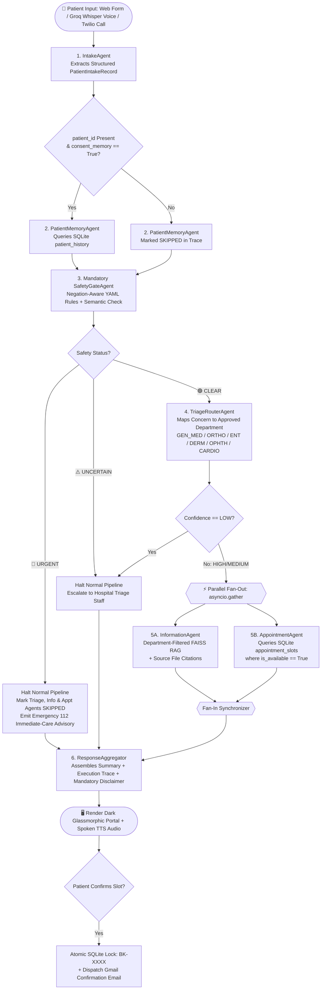
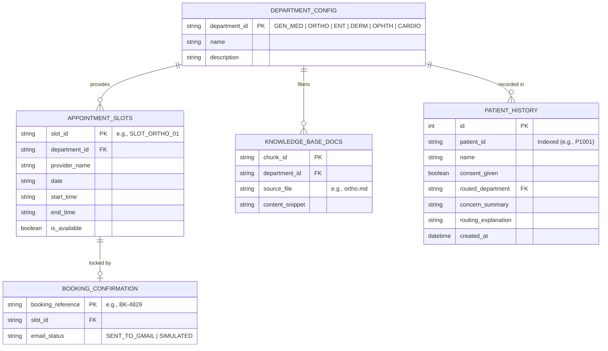

<div align="center">

# 🏥 AegisHealth AI — Multi-Agent Hospital Intake & Triage Command Center

**A Hierarchical Multi-Agent System with Mandatory Safety Gate, Department-Filtered FAISS RAG, Consent-Based Patient Memory, Voice AI Intake, and Automated Appointment Notifications**

[](https://www.python.org/)
[](https://learn.microsoft.com/en-us/agent-framework/overview/)
[](https://groq.com/)
[](https://fastapi.tiangolo.com/)
[](https://react.dev/)
[](https://github.com/facebookresearch/faiss)
[](https://www.sqlite.org/)

---

> ⚠️ **Non-Clinical Administrative Boundary Disclaimer:**  
> *AegisHealth AI is strictly an administrative hospital department routing and intake preparation assistant. It **never** diagnoses diseases, prescribes treatments, or replaces consultation with a qualified healthcare professional. All outputs enforce a mandatory clinical disclaimer, and urgent red-flag symptoms immediately terminate automated routing in favor of emergency care (`112`).*

</div>

---

## 🌟 Project Overview

Hospital front desks face severe bottlenecks when routing outpatient inquiries: patients are often unsure which specialist department to consult, what documents or prior reports to bring, or whether their symptoms warrant immediate emergency intervention. Meanwhile, standard monolithic LLM chatbots suffer from hallucinated medical diagnoses, fabricated appointment slots, and a lack of enforceable safety circuit breakers.

**AegisHealth AI** solves this using a **Hybrid Neuro-Symbolic Multi-Agent Architecture**:
- **LLM Agents (`Groq Llama-3.3-70B` via `Microsoft Agent Framework`)** handle unstructured natural-language extraction, semantic department triage, and grounded instruction synthesis.
- **Deterministic Python Services** enforce negation-aware clinical safety rules (`safety_rules.yaml`), strict consent verification, atomic SQLite slot reservation, and metadata-filtered vector retrieval.
- **Multimodal Voice & Text Interface** allows patients to either fill out a smart intake form or speak naturally into an **Automated Hospital Call Console** powered by **Groq Whisper (`whisper-large-v3-turbo`)** and browser Text-to-Speech (`TTS`), with an optional **Twilio Programmable Voice (`TwiML`)** webhook adapter.

---

## ✨ Key Architectural Highlights

| Capability | Engineering Implementation |
| :--- | :--- |
| **🛡️ Mandatory Safety Gate (Circuit Breaker)** | Executes **before** department routing on every request. Combines deterministic YAML rules (`config/safety_rules.yaml`), negation-window scanning (*"no chest pain"* $\rightarrow$ `CLEAR`), and fail-closed semantic verification. Halts downstream agents on `URGENT` or `UNCERTAIN` triggers. |
| **🧠 6 Specialized Modular Agents** | `IntakeAgent`, `PatientMemoryAgent`, `SafetyGateAgent`, `TriageRouterAgent`, `InformationAgent`, and `AppointmentAgent` coordinated by a central `Supervisor` & `ResponseAggregator`. |
| **⚡ Parallel Fan-Out / Fan-In Execution** | Once a department is selected, `InformationAgent` (FAISS RAG) and `AppointmentAgent` (SQLite availability) execute **concurrently** via `asyncio.gather` to minimize latency. |
| **📚 Department-Filtered FAISS RAG** | Embeds hospital Markdown knowledge base (`backend/knowledge_base/*.md`) using `sentence-transformers/all-MiniLM-L6-v2` into FAISS. Enforces strict `department_id` metadata filtering to prevent cross-department leakage and attaches source citations (e.g., `📄 ortho.md`). |
| **🗂️ Consent-Gated Returning Patient Memory** | Recognizes returning patients (e.g., `P1001`) **only** when `consent_memory=True`. Surfaces prior routing (`ENT`) as historical context without ever overriding current symptom triage or bypassing the Safety Gate. |
| **🎙️ Voice AI Call Console + Twilio Adapter** | Transcribes spoken patient concerns via Groq Whisper, auto-populates structured intake schemas, speaks responses aloud via TTS, and exposes `/api/twilio/voice` for inbound telephone integration. |
| **📧 Atomic Slot Booking & Gmail Dispatch** | Locks selected SQLite appointment slots (`is_available=False`), generates a booking reference (`BK-XXXX`), and dispatches an HTML confirmation ticket via `smtplib` SSL to the configured Gmail inbox. |
| **🔍 Full Agent Execution Trace Inspector** | Logs a real-time, timestamped execution trace (`COMPLETED`, `STOPPED`, `SKIPPED`, `FAILED`) for every agent node so evaluators can inspect the exact decision path. |

---

## 🏗️ System Architecture & Workflow Graph

*(GitHub natively renders the Mermaid diagrams below)*



---

## 🤖 Agent Roster & Responsibilities

Each agent is implemented as a standalone module inside `backend/agents/` and communicates strictly via typed Pydantic v2 schemas (`backend/schemas/workflow_state.py`):

| # | Agent Module | Input Schema | Output Schema | Core Responsibility & Guardrails |
| :-: | :--- | :--- | :--- | :--- |
| **1** | `intake_agent.py` | Raw Text / Voice Transcript | `PatientIntakeRecord` | Extracts patient name, age, concern, duration, and memory consent flag. **Guardrail:** Never converts symptoms into disease names. |
| **2** | `patient_memory_agent.py` | `PatientIntakeRecord` | `Optional[PatientMemoryRecord]` | Queries SQLite `patient_history` if and only if `consent_memory=True`. **Guardrail:** Historical context only; never overrides fresh triage. |
| **3** | `safety_gate.py` | `PatientIntakeRecord` | `SafetyAssessment` | Evaluates `config/safety_rules.yaml` with negation prefix scanning (`"no chest pain"` $\neq$ urgent). Returns `URGENT`, `UNCERTAIN`, or `CLEAR`. **Guardrail:** Fail-closed on any exception. |
| **4** | `triage_router.py` | `PatientIntakeRecord` + Context | `RoutingDecision` | Maps non-urgent concerns to one of 6 departments (`config/departments.yaml`) with neutral explanation and confidence level. |
| **5** | `information_agent.py` | `RoutingDecision` + `PatientIntakeRecord` | `DepartmentInformation` | Queries FAISS index (`rag_service.py`) filtered strictly by `department_id`. Returns location, preparation checklist, documents to bring, and `.md` citations. |
| **6** | `appointment_agent.py` | `RoutingDecision` | `List[AppointmentSlot]` | Queries SQLite `appointment_slots` for real future availability in the routed department. **Guardrail:** Never fabricates slots. |
| **7** | `response_aggregator.py` | `WorkflowState` | `WorkflowState` (Finalized) | Synthesizes outputs from active branches, logs the final trace event, and enforces the mandatory healthcare consultation disclaimer. |

---

## 🗄️ Database Schema (ER Diagram)



---

## 📂 Repository Folder Structure

```text
hospital-intake-assistant/
├── .env.example                     # Template environment variables
├── requirements.txt                 # Python dependencies
├── README.md                        # Project documentation
├── backend/
│   ├── main.py                      # FastAPI application & REST endpoints
│   ├── config/
│   │   ├── settings.py              # Pydantic settings & .env loader
│   │   ├── safety_rules.yaml        # Configurable urgent/uncertain rules & negation prefixes
│   │   └── departments.yaml         # Approved hospital department registry
│   ├── schemas/
│   │   └── workflow_state.py        # Strongly-typed Pydantic v2 agent data contracts
│   ├── database/
│   │   ├── db.py                    # SQLAlchemy 2.0 models & SQLite engine
│   │   └── seed.py                  # Idempotent synthetic slots & P1001 patient seeder
│   ├── knowledge_base/              # Synthetic hospital department Markdown documents
│   │   ├── gen_med.md
│   │   ├── ortho.md
│   │   ├── ent.md
│   │   ├── derm.md
│   │   ├── ophth.md
│   │   └── cardio.md
│   ├── services/
│   │   ├── safety_rule_service.py   # Negation-aware deterministic safety rule engine
│   │   ├── rag_service.py           # FAISS + SentenceTransformers metadata-filtered RAG
│   │   ├── appointment_service.py   # SQLite slot queries & atomic booking confirmation
│   │   ├── patient_memory_service.py# Consent-enforced returning patient history lookup
│   │   ├── voice_service.py         # Groq Whisper STT transcription & intake extraction
│   │   └── email_service.py         # Gmail SMTP SSL confirmation email dispatcher
│   ├── agents/
│   │   ├── llm_client.py            # Microsoft Agent Framework + Groq OpenAI-compatible client
│   │   ├── intake_agent.py          # Agent 1: Patient intake extraction
│   │   ├── patient_memory_agent.py  # Agent 2: Returning patient memory context
│   │   ├── safety_gate.py           # Agent 3: Mandatory safety boundary
│   │   ├── triage_router.py         # Agent 4: Non-diagnostic department router
│   │   ├── information_agent.py     # Agent 5: Grounded RAG instruction retriever
│   │   ├── appointment_agent.py     # Agent 6: Available slot retriever
│   │   ├── response_aggregator.py   # Agent 7: Output synthesizer & disclaimer enforcer
│   │   └── supervisor.py            # Central hierarchical supervisor
│   ├── workflows/
│   │   └── hospital_workflow.py     # Conditional branching & parallel fan-out orchestrator
│   ├── test_milestone1.py           # Tests: DB seeding, negation safety rules, consent memory
│   ├── test_milestone2.py           # Tests: FAISS RAG isolation & individual agent contracts
│   ├── test_milestone3.py           # Tests: All 4 end-to-end multi-agent workflow journeys
│   ├── test_milestone4_api.py       # Tests: FastAPI REST endpoints & slot locking
│   └── test_milestone5.py           # Tests: Voice transcription, Twilio TwiML, Gmail service
└── frontend/
    ├── package.json
    ├── vite.config.ts
    └── src/                         # React + TypeScript Dark Glassmorphic Command Center UI
```

---

## 🚀 Quickstart & Installation Guide

### 1. Clone the Repository & Set Up Python Environment
```bash
git clone <your-repo-url>
cd hospital-intake-assistant

# Create and activate virtual environment
python -m venv venv
# Windows:
venv\Scripts\activate
# macOS / Linux:
source venv/bin/activate

# Install backend dependencies
pip install -r requirements.txt
```

### 2. Configure Environment Variables (`.env`)
Copy `.env.example` to `.env` in the project root and add your credentials:
```bash
cp .env.example .env
```

Edit `.env`:
```env
# Primary LLM & Whisper Voice Provider (Groq)
GROQ_API_KEY=gsk_your_actual_groq_api_key_here
LLM_MODEL=llama-3.3-70b-versatile
LLM_BASE_URL=https://api.groq.com/openai/v1

# SQLite Database
DATABASE_URL=sqlite:///./hospital.db

# Optional: Real Gmail Booking Notifications (uses Google 16-char App Password)
GMAIL_SENDER_EMAIL=your_email@gmail.com
GMAIL_APP_PASSWORD=abcd efgh ijkl mnop
OPERATOR_NOTIFICATION_EMAIL=your_email@gmail.com
```
*(Note: If Gmail credentials or the Groq key are omitted during offline grading, the system automatically activates resilient deterministic fallbacks and simulated email previews so tests and demos never crash!)*

### 3. Start the FastAPI Backend Server
```bash
uvicorn backend.main:app --reload --port 8000
```
- **API Base URL:** `http://localhost:8000`
- **Interactive Swagger Docs:** `http://localhost:8000/docs`

### 4. Start the React Frontend Portal
Open a second terminal:
```bash
cd frontend
npm install
npm run dev
```
- **Frontend UI:** Open `http://localhost:5173` in your browser.

---

## 🎮 Live Demo Walkthrough (One-Click Grading Scenarios)

The frontend includes **4 One-Click Demo Scenario Cards** at the top of the Command Center so evaluators can test every conditional branch in seconds:

1. **🟢 Scenario 1: Normal Outpatient Routing (`Knee Pain` $\rightarrow$ `Orthopaedics`)**
   - **What happens:** `IntakeAgent` structures the concern $\rightarrow$ `SafetyGateAgent` verifies `CLEAR` (even if the user mentions *"no chest pain"*) $\rightarrow$ `TriageRouterAgent` selects `ORTHO` $\rightarrow$ `InformationAgent` (`ortho.md`) and `AppointmentAgent` execute **in parallel** $\rightarrow$ User clicks **"Confirm & Notify Gmail"** to lock the SQLite slot (`BK-XXXX`) and receive an email confirmation.
2. **🔴 Scenario 2: Urgent Safety Gate Stop (`Crushing Chest Pain` $\rightarrow$ `Immediate Care 112`)**
   - **What happens:** `SafetyGateAgent` matches urgent rules (`RULE_URG_01`), marks status `URGENT`, and **immediately halts normal routing**. In the right-hand Execution Trace, `TriageRouterAgent`, `InformationAgent`, and `AppointmentAgent` are visibly marked **`SKIPPED`**. A Crimson Emergency `112` card is displayed and spoken via TTS.
3. **🟣 Scenario 3: Returning Patient WITH Consent (`Patient P1001` $\rightarrow$ `Prior ENT` + `New Skin Rash`)**
   - **What happens:** `PatientMemoryAgent` verifies `consent_memory=True` and retrieves `P1001`'s historical `ENT` visit. However, the new concern still passes through the `SafetyGateAgent` and is routed fresh by `TriageRouterAgent` to **`DERM` (Dermatology)**—proving that historical memory never overrides current symptoms.
4. **⚪ Scenario 4: Returning Patient WITHOUT Consent (`Patient P1001` $\rightarrow$ `Consent Off`)**
   - **What happens:** Because the consent toggle is disabled, `PatientMemoryAgent` is marked **`SKIPPED`** in the execution trace and no prior records are accessed.
5. **🎙️ Scenario 5: Interactive Voice Call Console**
   - Click **"🎙️ Speak Your Concern"**, describe your symptoms naturally into your microphone, watch **Groq Whisper** transcribe and auto-extract your intake details, and listen as the AI Voice Receptionist speaks your department routing and booking confirmation aloud.

---

## 🔌 REST API Endpoints Summary

| Method | Endpoint | Description |
| :---: | :--- | :--- |
| `GET` | `/api/health` | Health check and active subsystem status |
| `GET` | `/api/departments` | Returns configured hospital departments from `departments.yaml` |
| `POST` | `/api/intake` | Executes the full multi-agent intake workflow and returns `WorkflowState` + execution trace |
| `GET` | `/api/intake/{run_id}/trace` | Retrieves the step-by-step `AgentExecutionEvent` trace for a specific workflow run |
| `GET` | `/api/patients/{patient_id}/history` | Retrieves returning patient routing history (requires `consent=true`) |
| `DELETE` | `/api/patients/{patient_id}/memory` | Deletes stored patient routing history (GDPR/privacy compliance) |
| `POST` | `/api/appointments/confirm` | Atomically reserves an available SQLite slot (`BK-XXXX`) and triggers Gmail notification |
| `POST` | `/api/voice/transcribe` | Transcribes audio via Groq Whisper (`whisper-large-v3-turbo`) & extracts structured intake fields |
| `POST` | `/api/twilio/voice` | Inbound Twilio Programmable Voice webhook returning dynamic `TwiML` XML voice responses |

---

## 🧪 Running the Automated Test Suite

The project includes comprehensive milestone-by-milestone verification scripts and `pytest` suites covering negation handling, RAG metadata isolation, safety gate circuit breaking, consent enforcement, API routes, voice transcription, and Gmail notifications:

```bash
# Run the complete test suite via pytest
pytest

# Or run individual milestone verification scripts directly:
python -m backend.test_milestone1
python -m backend.test_milestone2
python -m backend.test_milestone3
python -m backend.test_milestone4_api
python -m backend.test_milestone5
```

---

## 🛡️ Security, Privacy & Clinical Safety Guardrails

- **No Disease Diagnosis:** System prompts and output schemas strictly prohibit naming diseases, prescribing medication, or claiming a patient is medically safe.
- **Authoritative Deterministic Safety Rules:** LLM interpretation can assist but can **never** override a deterministic urgent match in `config/safety_rules.yaml`.
- **Fail-Closed Design:** Any unexpected exception inside the Safety Gate defaults to `UNCERTAIN` and escalates to human staff rather than allowing unverified routing.
- **Consent-First Memory & Sanitized Notifications:** Prior routing records are gated by explicit boolean consent, and outbound Gmail booking confirmations include only administrative slot details (`BK-XXXX`, department, doctor, time)—never raw symptom descriptions.